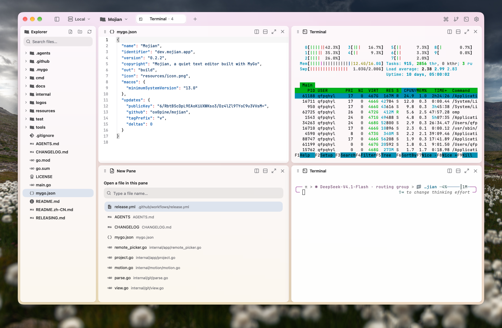

<p align="center">
  
</p>

<h1 align="center">Mojian · 墨间</h1>

<p align="center"><em>Words on paper. The tool steps back.</em></p>

<p align="center">
  macOS 13+ &nbsp;·&nbsp; Linux amd64/arm64 &nbsp;·&nbsp; Windows 10/11 amd64 &nbsp;·&nbsp; MyGo native UI &nbsp;·&nbsp; No webview &nbsp;·&nbsp; No cgo
</p>

<p align="center">
  <a href="README.zh-CN.md">简体中文</a> &nbsp;·&nbsp; <a href="https://github.com/ox0pine/mojian/releases">Releases</a>
</p>

<p align="center">
  
</p>
<p align="center"><sub>A folder on the left, a note in front, and nothing else asking for attention.</sub></p>

## What Mojian is

Mojian is a quiet plain-text editor that works on ordinary folders. There
is no library, index, database or account: a project is the folder you
opened, and a note is the file on disk.

A tab holds tiled panes. A pane can edit a file, preview an image or PDF,
or — on macOS and Linux — run a terminal. The window is drawn by
[MyGo](https://mygo.egoist.dev) as native UI: Metal on macOS, GTK 3 on
Linux, Direct3D 11 on Windows. There is no webview, no Electron and no
JavaScript build.

The Chinese name 墨间 (mò jiān) is ink, and the space it needs. The tool
steps behind the paper, the file stays in front of you, and the pace of
writing stays yours.

## Platform support

| Platform | Requirements | Release | Editor, Explorer, Git | Terminal, SSH, remote projects |
|---|---|---|---|---|
| macOS 13+ | Apple Silicon or Intel | `.dmg` | Yes | Yes |
| Linux amd64 / arm64 | GTK 3 | `.deb`, `.tar.gz` | Yes | Yes |
| Windows 10/11 amd64 | none | portable `.zip` | Yes | Not in 0.1.1 |

The Windows build is a portable, editor-focused release. Its menus,
palettes and Settings hide the terminal, SSH and remote-project features
that depend on the Unix session server. Those features remain available
on macOS and Linux. CI builds the Windows target and runs its headless
test suite on a Windows runner.

## Install

Download the latest build from
[Releases](https://github.com/ox0pine/mojian/releases).

### macOS

- `mojian-<version>-arm64.dmg` for Apple Silicon
- `mojian-<version>-amd64.dmg` for Intel

Open the disk image and drag Mojian into Applications. Release builds are
ad-hoc signed rather than notarized; if macOS blocks the first launch,
right-click Mojian in Finder and choose **Open**.

### Linux

Install the Debian package:

```sh
sudo apt install ./mojian_<version>_<arch>.deb
```

Or install the archive per user without root: put `install.sh` and
`mojian-<version>-linux-<arch>.tar.gz` in one folder, then run:

```sh
sh install.sh
```

The Linux app needs GTK 3 and a desktop session.

### Windows

Extract `mojian-<version>-windows-amd64.zip` and run `Mojian.exe`. Keep
`ghostty-vt.dll` beside it. The executable is unsigned, so SmartScreen may
ask you to confirm the first launch.

## The editor

### A project is a folder

`Cmd+O` on macOS or `Ctrl+O` on Linux and Windows opens any folder. The
chips at the top left switch between recent projects; on macOS and Linux
they also switch between local and server projects. Each project keeps its
own tabs, panes and recent files. With no project chosen, the first launch
opens `~/Documents/Mojian` and leaves a welcome note when the folder is
empty.

### Writing comes first

Edits stay in memory until you save. `Cmd+S` / `Ctrl+S` writes atomically,
and unsaved work is written when the window closes. Syntax highlighting
covers Python, JavaScript, TypeScript, Go, Rust, C and C++, Swift, Kotlin,
Ruby, JSON, YAML, TOML, SQL, HTML, CSS, Markdown and more. Code keeps line
numbers; prose wraps.

Markdown panes switch between source and preview from the header, and
Settings › Editor can render new `.md` files by default. Images, including
SVG, open in a contained viewer; PDFs render page by page when `pdftoppm`
is installed, with a Quick Look first page on macOS.

### Tabs, panes and the Explorer

A tab is a workspace made of panes. A split opens an empty pane with an
inline file search. Drag a pane by its header onto another pane's edge to
insert it there, or use `Option+Shift` / `Alt+Shift` and the arrows.
`Option` / `Alt` and the arrows move pane focus. `Shift+Cmd+M` on macOS or
`Ctrl+Shift+M` on Linux and Windows zooms the focused pane.

`Shift+Cmd+B` / `Ctrl+Shift+B` toggles the Explorer. Its search field
filters files, and **Open File** (`Shift+Cmd+O` / `Ctrl+Shift+O`) opens the
Explorer with that field focused. The Explorer creates files and folders;
right-click offers open, rename, duplicate, copy, cut, copy path, reveal
and move to trash; folders and empty space accept paste. Generated trees
such as `.git`, `node_modules`, `dist` and `build` stay out of sight.

### Terminals and servers (macOS and Linux)

`Shift+Cmd+T` / `Ctrl+Shift+T` opens a real terminal at the project root.
Shells run in a detached session server, so quitting Mojian detaches them
and reopening reattaches. `Shift+Cmd+L` / `Ctrl+Shift+L` opens an SSH
terminal from `~/.ssh/config`.

Add a host in Settings › Hosts, then choose it from the server chip. Mojian
prepares a small per-user session server over `ssh`, forwards its Unix
socket and mirrors the project into a local cache; saves are written back.
No root, no listening port and no system service are installed.

### Git and the command palette

`Shift+Cmd+G` / `Ctrl+Shift+G` shows the working tree against `HEAD`:
statuses on the left, a two-gutter diff on the right. Staged, unstaged and
untracked work are all included.

`Shift+Cmd+P` / `Ctrl+Shift+P` searches commands, files and tabs with fuzzy
matching. `Cmd+,` / `Ctrl+,` opens Settings: General, Appearance, Editor,
Fonts, Terminal, Shell, Notifications, Keyboard, Hosts, Git and Advanced.
The window follows the system appearance by default; View › Appearance
overrides it.

## Keyboard shortcuts

The in-app labels follow the platform. This table shows both spellings.

| Action | macOS | Linux / Windows |
|---|---|---|
| Open project | `⌘O` | `Ctrl+O` |
| Open file | `⇧⌘O` | `Ctrl+Shift+O` |
| New file | `⌘N` | `Ctrl+N` |
| New folder | `⇧⌘N` | `Ctrl+Shift+N` |
| Rename selected entry | `F2` | `F2` |
| Move selected entry to Trash | `⌘⌫` | `Ctrl+Backspace` |
| Save | `⌘S` | `Ctrl+S` |
| New tab | `⌘T` | `Ctrl+T` |
| Close pane / tab | `⌘W` / `⇧⌘W` | `Ctrl+W` / `Ctrl+Shift+W` |
| Next / previous tab | `⌃⇥` / `⌃⇧⇥` | `Ctrl+Tab` / `Ctrl+Shift+Tab` |
| Show tab 1–9 | `⌘1…⌘9` | `Ctrl+1…Ctrl+9` |
| Split right / down | `⇧⌘D` / `⇧⌘E` | `Ctrl+Shift+D` / `Ctrl+Shift+E` |
| Split left / up | `⌥⌘←` / `⌥⌘↑` | `Ctrl+Alt+Left` / `Ctrl+Alt+Up` |
| Focus neighboring pane | `⌥` + arrows | `Alt` + arrows |
| Move focused pane | `⌥⇧` + arrows | `Alt+Shift` + arrows |
| Zoom pane | `⇧⌘M` | `Ctrl+Shift+M` |
| Toggle Explorer | `⇧⌘B` | `Ctrl+Shift+B` |
| Toggle terminal | `⇧⌘T` | `Ctrl+Shift+T` |
| SSH terminal | `⇧⌘L` | `Ctrl+Shift+L` |
| Git diff page | `⇧⌘G` | `Ctrl+Shift+G` |
| Command palette | `⇧⌘P` | `Ctrl+Shift+P` |
| Settings | `⌘,` | `Ctrl+,` |

Terminal and SSH shortcuts are available on macOS and Linux only.
Double-click a tab to rename it; double-click a pane header to zoom it.
Right-click a tab for its menu.

## Build from source

Mojian needs Go 1.27.3 or later.

```sh
git clone https://github.com/ox0pine/mojian.git
cd mojian

go tool mygo dev        # live-reloading development app
go test ./...           # unit and integration tests
go tool mygo vet .      # go vet plus MyGo's UI lifetime checks
```

Build the release targets you need:

```sh
go tool mygo build -platform darwin/arm64,darwin/amd64
go tool mygo build -platform linux/amd64,linux/arm64
go tool mygo build -platform windows/amd64
```

The output lives under `build/<os>-<arch>/`. macOS produces `.app` and
`.dmg`; Linux produces `.tar.gz` and `.deb`; Windows produces `Mojian.exe`
and its DLL. MyGo is pinned as a Go tool in `go.mod`, so the first
`go tool mygo` downloads the exact version.

`go tool mygo dev -web` opens the interface in a browser, with files kept
in memory. After changing the session protocol or `cmd/mojian-server`,
rebuild the embedded remote binaries with `sh tools/build-remote.sh`.

## Release

A release is a tag. Pushing `vX.Y.Z` runs
[`.github/workflows/release.yml`](.github/workflows/release.yml), which
tests the tree, builds every platform, creates a draft release, uploads
the installers and `SHA256SUMS`, and publishes only when every upload
succeeds. See [`RELEASING.md`](RELEASING.md).

Each release contains:

- macOS: `mojian-<version>-arm64.dmg`, `mojian-<version>-amd64.dmg`
- Linux: `mojian-<version>-linux-{amd64,arm64}.tar.gz`, matching `.deb` packages, `install.sh`
- Windows: `mojian-<version>-windows-amd64.zip`
- `SHA256SUMS`

## Design

Ink `#1F1B16`, paper `#FBF7EF`, vermilion `#D24A2B`. In Mojian's identity
almost everything is ink on paper; only the cursor keeps the vermilion —
the one voice the page raises. Marks and exports live in
[`logos/README.md`](logos/README.md).

## Credits

Action icons by [Lucide](https://lucide.dev) (ISC); file icons by
[Material Icon Theme](https://github.com/PKief/vscode-material-icon-theme)
(MIT); type set in [JetBrains Mono](https://www.jetbrains.com/lp/mono/)
(OFL); terminals driven by libghostty-vt and PTYs by
[creack/pty](https://github.com/creack/pty) (MIT). The logo is ink, paper
and one vermilion cursor, its wordmark outlining Literata (SIL OFL).
Window and interaction follow [GoRex](https://github.com/egoist/gorex);
remote hosts and Settings follow [Kero](https://kero.sh). Drawn with
[MyGo](https://mygo.egoist.dev).
