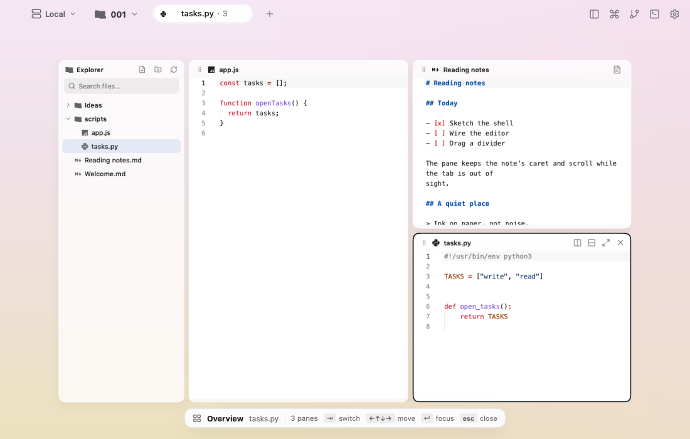
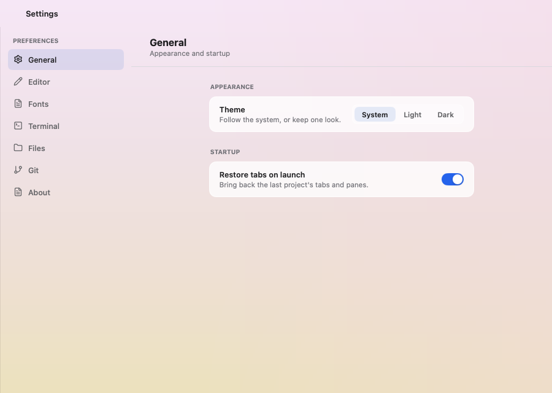

# Mojian

<p align="center"></p>

A quiet text editor for plain files, built with [MyGo](https://mygo.egoist.dev)'s
native UI: no webview, no cgo, one small Go binary. Tabs hold workspaces,
workspaces hold panes, and every pane edits a file with syntax highlighting.


## What it does

- **Projects, not a fixed vault.** The chip at the top left names the open
  project and switches to a recent one, or opens any folder with `⌘O`. The
  folder chooser is part of the app, with the same colors and controls as the
  rest of the window. Each project keeps its own tabs and layout.
- **An Explorer, not a file list.** `⇧⌘B` shows the project's folders and files,
  including pictures and PDFs. New File and New Folder live in its header; right-click an entry for
  Open in Current Window, Open in New Tab, Rename, Duplicate, Copy, Cut,
  Paste, Copy Path, Reveal in Finder, and Move to Trash. The tree reloads when the window
  regains focus, so a file made in the terminal appears.
- **Code, not only Markdown.** Python, JavaScript, TypeScript, Go, Rust, C, C++,
  Swift, Kotlin, JSON, YAML, TOML, SQL, HTML, CSS, Markdown and the rest of
  MyGo's languages are highlighted. Code files get line numbers; prose wraps
  instead of scrolling sideways. File rows use Material Icon Theme's
  per-language icons.
- **Tabs and split panes.** A tab is a workspace; each pane is an editor.
  The `+` beside the tabs opens an empty workspace, not a copy of the current
  one. Split left, right, up or down and choose the file for the new pane; a
  split never opens the same file twice. A tab tiles as many panes as you
  split, without a four-pane limit. Drag a pane's top-left grip onto another
  pane to swap them, or onto its edge to put the pane above, below, left or
  right of it. Drag a divider to resize, double-click it for half and half,
  zoom a pane, or close it.
  Option+Tab zooms the workspace out into the niri-style pane switcher:
  Tab, the arrow keys or a click move between panes, Return focuses the chosen
  one, and Escape closes the switcher.
  
- **Markdown, source or rendered.** A Markdown pane has a Preview button at
  the top right; `⇧⌘V` is not needed, and the setting opens new `.md` files
  rendered when preferred.
- **Pictures and PDFs.** Images open in a contained viewer, SVGs and animated
  GIFs included. A PDF shows its first page through macOS Quick Look (or
  `pdftoppm` when installed), with Open for the system reader.
- **Settings in their own window.** `⌘,`, the gear, or the palette opens a
  separate window, after Kero: searchable categories on the left, settings on
  the right. General, Appearance, Editor, Fonts, Terminal, Shell, Notifications,
  Keyboard, Hosts, Git and Advanced cover installed fonts, type, line height,
  tab size, wrapping, Markdown, server hosts, terminal input and startup.
  Every change applies and is saved at once.
  

- **Servers and projects.** The server chip sits left of the project name.
  Pick Local or an SSH host, then choose a directory on it. `~/.ssh/config`
  supplies aliases, keys, ProxyJump and the agent. On first use Mojian uploads
  a small per-user server to the host over SSH; it needs no root and opens no
  port. The same project can be edited, its Git diff read, and its terminals
  run on the server. Sessions keep running when you quit; reopening the app
  reconnects the host and restores the project, layout and sessions.
  The host model follows [Kero](https://kero.sh).
- **A terminal inside the window.** `⇧⌘T` opens a terminal pane on the right,
  in the selected folder. It tiles with the same split, zoom and close
  controls as a file pane, and a pane's grip moves it like any other tile;
  `⇧⌘T` again closes it. It is a
  real terminal (the MyGo terminal plugin, libghostty-vt) with colors,
  selection and clipboard.
- **A Git diff page.** `⇧⌘G` shows the working tree against `HEAD`: changed
  files on the left, and a line-numbered diff with tinted additions and
  deletions on the right. The header shows the branch, file count, status,
  change stats and an Open action; double-click a changed file to open it.
- **Plain files, saved when you ask.** `⌘S` writes atomically; edits stay in
  memory until you save. The layout comes back after a restart.
- **A command palette.** `⇧⌘P` runs every command and jumps to any file or tab.
- **Light, dark, or the system.** Both palettes are hand-tuned; the window
  follows the system by default, and View ▸ Appearance overrides it.

## Shortcuts

| macOS | Action |
|---|---|
| `⌘O` | Open project folder |
| `⇧⌘O` | Find a file |
| `⌘N` | New file |
| `⇧⌘N` | New folder |
| `⌘T` | New tab |
| `⇧⌘B` | Show or hide the Explorer |
| `⇧⌘T` | Open or close the terminal pane |
| `⇧⌘L` | Connect to an SSH host |
| `⇧⌘G` | Show the Git diff page |
| `⌥⇥` | Toggle the pane overview |
| `⇧⌘D` / `⇧⌘E` | Split right / down |
| `⌥⌘←` / `⌥⌘↑` | Split left / up |
| `⌘W` / `⇧⌘W` | Close pane / tab |
| `⇧⌘M` | Zoom the pane |
| `⌃⌘=` | Equalize panes |
| `⌘1…⌘9` | Show tab |
| `⌃⇥` / `⌃⇧⇥` | Next / previous tab |
| `⇧⌘R` | Rename tab |
| `⇧⌘P` | Command palette |
| `⌘,` | Settings |
| `⌘S` | Save now |

Double-click a tab to rename it; double-click a pane's header to zoom it.

## Develop

Mojian needs Go 1.27 or later. MyGo is pinned in `go.mod` as a tool, so no
global install and no Bun are needed:

```sh
go tool mygo dev     # Mojian Dev, rebuilt as the code changes
go test ./...        # the model, the store and the view, without a window
go tool mygo build   # build/darwin-arm64/Mojian.app and a .dmg
```

`mygo dev` uses the same default project (`~/Documents/Mojian`), but its window
state and preferences live in `Mojian Dev`, apart from the installed app.
`MOJIAN_VAULT` names another project at launch. The last project and the recent
projects are kept in the app's settings, and each project's layout in
`layouts/` there.

The native UI can also be developed in a browser:

```sh
go tool mygo dev -web
```

There, the files live in memory for the session and the file system is not
touched; projects, Git and terminals need the desktop app.

## Layout

Go compiles one package per directory, so the root is only the entry point and
the app is split by concern under `internal/`. `internal/app` is the window's
view package: it holds the shell, tabs, panes, Explorer, pickers and settings.
The pieces that stand on their own are packages of their own.

| | |
|---|---|
| `main.go` | starts the app, or `-server` for the local session server |
| `cmd/mojian-server/` | the per-user server uploaded to SSH hosts |
| `internal/remotebin/` | the embedded Linux server and libghostty-vt builds |

| `internal/app/` | the window: shell, tabs, panes, Explorer, pickers, settings and the file operations |
| `internal/git/` | the working-tree page: status, diffs, parsing and its view |
| `internal/theme/` | light and dark palettes, the window gradient and fonts |
| `internal/icons/` | Lucide action icons and Material Icon Theme file icons |
| `internal/assets/` | the embedded icons, brand marks and JetBrains Mono |
| `logos/` | logo masters and PNG exports: mark, wordmark, lockups and app icon |
| `internal/motion/` | the page, pane, tab and tree transitions |
| `internal/session/` | PTYs, terminal snapshots, remote file operations and attach; used locally and by the uploaded server |
| `test/` | black-box integration tests and the helpers they share |

Go requires `_test.go` files that read unexported state to sit beside their
package, so those white-box tests stay in `internal/app`, `internal/git`,
`internal/icons` and `internal/theme`. The `test/` package holds black-box
integration tests, such as real Git working trees.

Inside `internal/app/`:

| | |
|---|---|
| `app.go` | the app, its window, menus, commands, settings and lifecycle |
| `store.go` | a project folder: text files, assets, new notes and atomic saves |
| `tree.go` | the file tree, folder creation and file search |
| `project.go` | the project switcher and recent projects |
| `term.go` | terminal panes, attached to the session server |
| `files.go` | file operations: rename, copy, move, trash and the context menu |
| `picker.go` | the in-window project folder chooser |
| `split.go` | the split file chooser |
| `model.go` | files, tabs, panes, the split tree and the saved layout |
| `view.go` | the title bar, pane cards and splitters |
| `tabs.go` | the tab strip and tab menu |
| `palette.go` | the command palette |
| `settings.go` | the Kero-inspired settings window |
| `remote.go` | SSH host connections, remote project mirrors and the server/project switcher |
| `ssh.go` | the SSH host picker and `~/.ssh/config` |
| `assetview.go` | image, PDF and Markdown preview rendering |

## Credits

Action icons: [Lucide](https://lucide.dev), ISC (`internal/assets/icons/LICENSE`).
File and folder icons: [Material Icon Theme](https://github.com/PKief/vscode-material-icon-theme), MIT (`internal/assets/icons/material/LICENSE`).
Font: [JetBrains Mono](https://www.jetbrains.com/lp/mono/), OFL
(`internal/assets/fonts/OFL.txt`).
Pseudo-terminals: [creack/pty](https://github.com/creack/pty), MIT.
The logo is by the Mojian project: ink, paper and one vermilion cursor;
the wordmark outlines Literata, SIL OFL. The window's shape and interaction follow [GoRex](https://github.com/egoist/gorex),
also built with MyGo. Remote hosts and the settings shape follow
[Kero](https://kero.sh).
