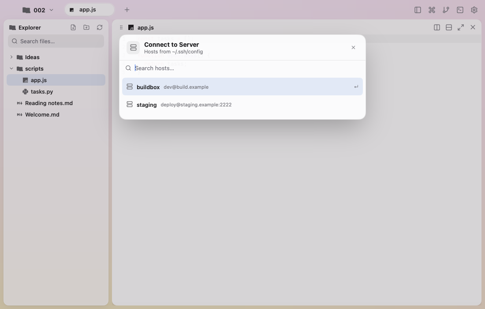

  

<h1 align="center">Mojian · 墨间</h1>

<em>Words on paper. The tool steps back.</em>

  macOS 13+ &nbsp;·&nbsp; MyGo native UI &nbsp;·&nbsp; No webview &nbsp;·&nbsp; Zero cgo

  <a href="README.md">English</a> &nbsp;·&nbsp; <a href="README.zh-CN.md">简体中文</a>

  

Reading and writing

  
  

Servers and Settings

## About

Mojian is a quiet editor for plain text. Every frame is drawn by [MyGo](https://mygo.egoist.dev)'s native UI: no webview, no cgo, no JavaScript build — one Go binary, rendered through Metal on macOS.

The Chinese name 墨间 (mò jiān) is ink, and the space it needs. The tool steps behind the paper, the file stays in front of you, and the pace of writing stays yours.

## Writing

- **A project is a folder.** Open any folder; nothing is imported, indexed or locked into a library. `⌘O` opens the in-window folder picker with places and recent projects, and the chips at the top left switch between projects and servers. Each project keeps its own tabs and pane layout. When no project is given, the first launch opens `~/Documents/Mojian`, leaving a welcome note when it is empty.
- **Plain files, saved on your word.** `⌘S` writes atomically; edits wait in memory until then, and are written when the window closes. Syntax highlighting covers the languages MyGo knows — Python, JavaScript, TypeScript, Go, Rust, C, C++, Swift, Kotlin, JSON, YAML, TOML, SQL, HTML, CSS, Markdown and more. Code keeps its line numbers; prose wraps.
- **An Explorer, not a list.** `⇧⌘B` opens the project tree; its search field filters files, and `⇧⌘O` takes you there. The header makes files and folders, and the tree re-reads the disk when the window regains focus. Right-click a file to open it here or in a new tab; every entry offers Rename (`F2`), Duplicate, Copy, Cut, Copy Path, Copy Relative Path, Reveal in Finder and Move to Trash (`⌘⌫`); folders and empty space take Paste. `.git`, `node_modules`, `dist` and `build` stay out of the way.
- **Tabs and split panes.** A tab is a workspace made of panes. A file split opens an empty pane with an inline file search; keep splitting and the tab keeps growing. Drag a pane by its grip onto another pane's edge to place it there, or move it with `⌥⇧` and the arrows. `⌥` and the arrows move the focus; `⇧⌘M`, or a double-click on the pane header, zooms it.
- **Markdown, both ways.** A Markdown pane switches between source and preview from its header; the Editor settings can open new `.md` files rendered. The preview reads the live buffer and keeps its own scroll.
- **Pictures and PDFs.** Images, SVG included, sit in a contained viewer with size and an Open action. PDFs render page by page — up to 60 — when `pdftoppm` is present, and fall back to a Quick Look first page otherwise.

## Space

- **A terminal inside the window.** `⇧⌘T` opens a real terminal pane at the project root; it tiles, splits, zooms and closes like any pane. The session outlives the window: quitting Mojian detaches it, and reopening reattaches. `⇧⌘L` starts an SSH terminal from `~/.ssh/config`.
- **Projects on a server.** The server chip moves between Local and the hosts in Settings › Hosts. On connection, Mojian prepares a lightweight session server on the host over `ssh`: no root, no listening port, no service installed. The remote project is mirrored locally and saves are written back; the Explorer, Git and terminals keep working. Hosts follow `~/.ssh/config`; the host workflow follows [Kero](https://kero.sh).
- **A Git diff page.** `⇧⌘G` shows the working tree against `HEAD`: changed files and their status on the left, a two-gutter diff with tinted additions and deletions on the right. Staged, unstaged and untracked work are all there. Double-click a file to open it; the refresh button re-reads at any time.
- **Settings in their own window.** `⌘,` opens a separate window after Kero: searchable categories on the left, settings on the right. General, Appearance, Editor, Fonts, Terminal, Shell, Notifications, Keyboard, Hosts, Git and Advanced cover type, wrapping, Markdown, fonts, terminal input and scrollback, notifications, hosts and data paths. Every change applies and is saved at once.
- **A command palette.** `⇧⌘P` lists commands, files and tabs with fuzzy matching, putting most of the app within reach of the keyboard.
- **Light, dark, or the system.** Both palettes are tuned by hand; the window follows the system by default, and View › Appearance overrides it.

## Shortcuts

| macOS | Action |
|---|---|
| `⌘O` | Open project folder |
| `⇧⌘O` | Find a file |
| `⌘N` | New file |
| `⇧⌘N` | New folder |
| `F2` | Rename the selected tree entry |
| `⌘⌫` | Move the selected tree entry to Trash |
| `⌘T` | New tab |
| `⌘W` / `⇧⌘W` | Close pane / tab |
| `⇧⌘R` | Rename tab |
| `⌃⇥` / `⌃⇧⇥` | Next / previous tab |
| `⌘1…⌘9` | Show tab |
| `⇧⌘B` | Show or hide the Explorer |
| `⇧⌘T` | Open or close the terminal pane |
| `⇧⌘L` | Open an SSH terminal |
| `⇧⌘G` | Show the Git diff page |
| `⇧⌘D` / `⇧⌘E` | Split right / down |
| `⌥⌘←` / `⌥⌘↑` | Split left / up |
| `⌥←` / `⌥→` / `⌥↑` / `⌥↓` | Move pane selection |
| `⌥⇧←` / `⌥⇧→` / `⌥⇧↑` / `⌥⇧↓` | Move the selected pane |
| `⇧⌘M` | Zoom the pane |
| `⇧⌘P` | Command palette |
| `⌘,` | Settings |
| `⌘S` | Save now |

Double-click a tab to rename it; double-click a pane's header to zoom it. Right-click a tab for Reset Name, Close Other Tabs and the rest of its menu.

## Ink and paper

Ink `#1F1B16`, paper `#FBF7EF`, vermilion `#D24A2B`. In Mojian's identity, nearly everything is ink on paper; only the cursor keeps the vermilion — the one voice the page raises. The marks and their exports live in [`logos/README.md`](logos/README.md).

## Credits

Action icons by [Lucide](https://lucide.dev) (ISC); file icons by [Material Icon Theme](https://github.com/PKief/vscode-material-icon-theme) (MIT); type set in [JetBrains Mono](https://www.jetbrains.com/lp/mono/) (OFL); terminals driven by libghostty-vt and PTYs by [creack/pty](https://github.com/creack/pty) (MIT). The logo is ink, paper and one vermilion cursor, its wordmark outlining Literata (SIL OFL). Window and interaction follow [GoRex](https://github.com/egoist/gorex); remote hosts and Settings follow [Kero](https://kero.sh). Drawn with [MyGo](https://mygo.egoist.dev).
