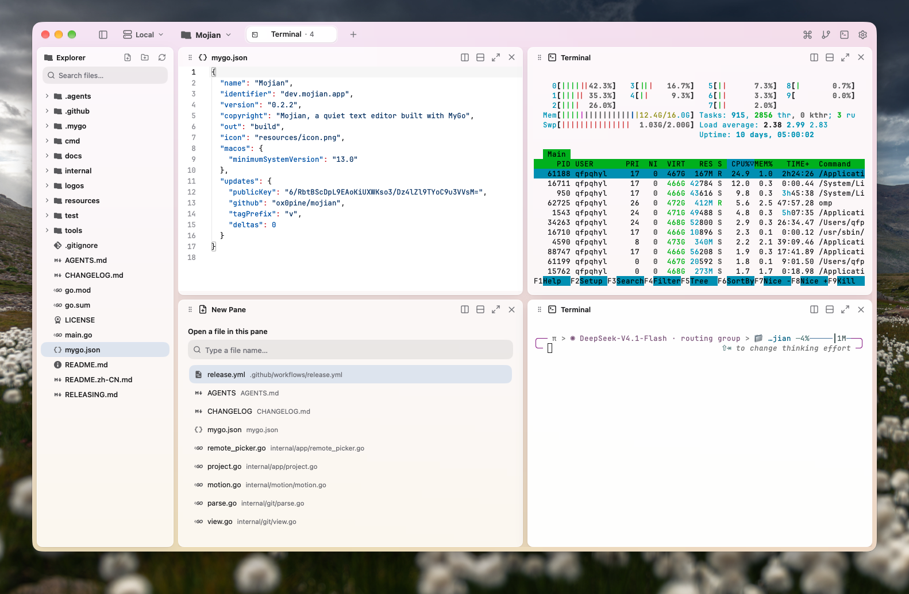

<p align="center">
  
</p>

<h1 align="center">墨间 · Mojian</h1>

<p align="center"><em>字落于纸，工具退于幕后。</em></p>

<p align="center">
  macOS 13+ &nbsp;·&nbsp; Linux amd64/arm64 &nbsp;·&nbsp; Windows 10/11 amd64 &nbsp;·&nbsp; MyGo 原生界面 &nbsp;·&nbsp; 无 WebView &nbsp;·&nbsp; 无 cgo
</p>

<p align="center">
  <a href="README.md">English</a> &nbsp;·&nbsp; <a href="https://github.com/ox0pine/mojian/releases">下载</a>
</p>

<p align="center">
  
</p>
<p align="center"><sub>左边是项目，眼前是文字，别无他物打扰。</sub></p>

## 墨间是什么

墨间是一款安静、克制的纯文本编辑器，直接打开普通文件夹。没有资料库、索引、数据库，也不需要账号：项目就是你打开的文件夹，笔记就是磁盘上的文件。

一个标签页由多个平铺窗格组成。每个窗格可以编辑文件、预览图片或 PDF；在 macOS 和 Linux 上，还可以运行终端。界面由 [MyGo](https://mygo.egoist.dev) 绘制为原生 UI：macOS 使用 Metal，Linux 使用 GTK 3，Windows 使用 Direct3D 11。没有 WebView、没有 Electron，也没有 JavaScript 构建流程。

**墨**是文字，**间**是留白。工具退到纸后，文件留在眼前；编辑的节奏，由你掌握。

## 平台支持

| 平台 | 系统要求 | 发布格式 | 编辑、文件树、Git | 终端、SSH、远程项目 |
|---|---|---|---|---|
| macOS 13+ | Apple Silicon 或 Intel | `.dmg` | 支持 | 支持 |
| Linux amd64 / arm64 | GTK 3 | `.deb`、`.tar.gz` | 支持 | 支持 |
| Windows 10/11 amd64 | 无额外依赖 | 便携 `.zip` | 支持 | 0.1.1 暂不支持 |

Windows 版是面向编辑的便携版本。依赖 Unix 会话服务器的终端、SSH 与远程项目功能会在菜单、命令面板和设置中隐藏；这些功能在 macOS 与 Linux 上保持完整。CI 会在 Windows 运行器上构建目标并运行无头测试。

## 安装

从 [Releases](https://github.com/ox0pine/mojian/releases) 下载最新构建。

### macOS

- Apple Silicon：`mojian-<版本>-arm64.dmg`
- Intel：`mojian-<版本>-amd64.dmg`

打开镜像，把墨间拖进「应用程序」。发布包采用 ad-hoc 签名、未经公证；如果系统拦截首次启动，请在 Finder 中右键墨间并选择「打开」。

### Linux

安装 Debian 包：

```sh
sudo apt install ./mojian_<版本>_<架构>.deb
```

或者安装到用户目录，不需要 root：把 `install.sh` 和
`mojian-<版本>-linux-<架构>.tar.gz` 放在同一目录，然后运行：

```sh
sh install.sh
```

Linux 版需要 GTK 3 和桌面会话。

### Windows

运行 `mojian-setup-<版本>-amd64.exe`，或解压
`mojian-<版本>-windows-amd64.zip` 后运行 `Mojian.exe`。请让
`ghostty-vt.dll` 与可执行文件保持在同一目录。程序未签名，首次启动时
SmartScreen 可能要求确认。

## 编辑器

### 项目即文件夹

macOS 用 `Cmd+O`，Linux 和 Windows 用 `Ctrl+O` 打开任意文件夹。左上角的徽标切换最近项目；在 macOS 和 Linux 上还可以切换本地与服务器项目。每个项目保留自己的标签页、窗格和最近文件。未指定项目时，首次启动会打开 `~/Documents/Mojian`，文件夹为空时留下一张欢迎笔记。

### 写作优先

编辑内容先留在内存，保存时才写入；`Cmd+S` / `Ctrl+S` 采用原子写入，关闭窗口时也会保存未提交的修改。语法高亮覆盖 Python、JavaScript、TypeScript、Go、Rust、C/C++、Swift、Kotlin、Ruby、JSON、YAML、TOML、SQL、HTML、CSS、Markdown 等语言。代码保留行号，散文自动换行。

Markdown 窗格可在源码与预览之间切换；设置 › 编辑器可以让新打开的 `.md` 默认显示渲染结果。图片（包括 SVG）在窗格内查看；安装 `pdftoppm` 后 PDF 可逐页渲染，macOS 还会回退到 Quick Look 首页。

### 标签页、窗格与文件树

标签页是窗格组成的工作区。拆分时先出现一个带内联文件搜索的空窗格。拖动窗格标题到另一个窗格的边缘，即可把它插入该位置；也可以用 `Option+Shift` / `Alt+Shift` 加方向键。`Option` / `Alt` 加方向键移动窗格焦点；`Shift+Cmd+M` / `Ctrl+Shift+M` 放大当前窗格。

`Shift+Cmd+B` / `Ctrl+Shift+B` 显示或隐藏文件树。文件树搜索框可以过滤文件；**打开文件**（`Shift+Cmd+O` / `Ctrl+Shift+O`）会在窗口中央打开项目文件选择框：输入即可过滤，按 Enter 或点击文件即可在当前标签页打开。文件树支持新建文件与文件夹；右键可打开、重命名、复制、剪切、复制路径、在文件管理器中显示、移到废纸篓；文件夹和空白处支持粘贴。`.git`、`node_modules`、`dist`、`build` 等生成目录默认隐藏。

### 终端与服务器（macOS / Linux）

`Shift+Cmd+T` / `Ctrl+Shift+T` 在项目根目录打开终端。本地终端运行在独立的会话服务器中：退出墨间只是断开，重新打开会接回原来的 shell。`Shift+Cmd+L` / `Ctrl+Shift+L` 从 `~/.ssh/config` 打开 SSH 终端。

在设置 › 主机中添加地址后，可从顶部服务器徽标选择。墨间通过 `ssh` 在远端启动小型用户级服务器，并直接编辑该目录：文件树只读取目录信息，打开文件时才读取内容，保存和文件操作直接写回远端，Git 也在远端运行。远程终端随 SSH 连接结束，断线后不会继续留在后台。不需要 root，不监听端口，也不安装系统服务。

### Git 与命令面板

`Shift+Cmd+G` / `Ctrl+Shift+G` 打开工作区页面：左侧是相对 `HEAD` 的变更状态，右侧是带行号栏的 diff。暂存、未暂存和未跟踪的改动都会列出。

`Shift+Cmd+P` / `Ctrl+Shift+P` 用模糊匹配搜索命令、文件和标签页。`Cmd+,` / `Ctrl+,` 打开独立设置窗口：通用、外观、编辑器、字体、终端、Shell、通知、快捷键、主机、Git、高级、更新。窗口默认跟随系统外观，也可在「视图 › 外观」中覆盖。

### 更新

设置 › 更新会检查 GitHub 上最新的签名版本。**检查更新**会提示当前已是最新版本，或给出新版本；**安装更新**会下载并校验签名；**重启更新**会应用已暂存的更新并重新启动墨间。检查在后台进行，不会阻塞编辑。

自动更新要求应用所在位置可写：macOS 应用包、Linux 用户目录安装，或你有写权限的 Windows 文件夹。安装在 `/opt` 的 `.deb` 和 Windows 全局安装版由包管理器负责更新。

## 快捷键

应用内会按平台显示对应按键；下表同时列出两种写法。

| 操作 | macOS | Linux / Windows |
|---|---|---|
| 打开项目 | `⌘O` | `Ctrl+O` |
| 打开文件 | `⇧⌘O` | `Ctrl+Shift+O` |
| 新建文件 | `⌘N` | `Ctrl+N` |
| 新建文件夹 | `⇧⌘N` | `Ctrl+Shift+N` |
| 重命名选中项 | `F2` | `F2` |
| 移到废纸篓 | `⌘⌫` | `Ctrl+Backspace` |
| 保存 | `⌘S` | `Ctrl+S` |
| 新建标签页 | `⌘T` | `Ctrl+T` |
| 关闭窗格 / 标签页 | `⌘W` / `⇧⌘W` | `Ctrl+W` / `Ctrl+Shift+W` |
| 下一个 / 上一个标签页 | `⌃⇥` / `⌃⇧⇥` | `Ctrl+Tab` / `Ctrl+Shift+Tab` |
| 显示标签页 1–9 | `⌘1…⌘9` | `Ctrl+1…Ctrl+9` |
| 向右 / 向下拆分 | `⇧⌘D` / `⇧⌘E` | `Ctrl+Shift+D` / `Ctrl+Shift+E` |
| 向左 / 向上拆分 | `⌥⌘←` / `⌥⌘↑` | `Ctrl+Alt+Left` / `Ctrl+Alt+Up` |
| 聚焦相邻窗格 | `⌥` + 方向键 | `Alt` + 方向键 |
| 移动当前窗格 | `⌥⇧` + 方向键 | `Alt+Shift` + 方向键 |
| 放大窗格 | `⇧⌘M` | `Ctrl+Shift+M` |
| 显示 / 隐藏文件树 | `⇧⌘B` | `Ctrl+Shift+B` |
| 打开 / 关闭终端 | `⇧⌘T` | `Ctrl+Shift+T` |
| SSH 终端 | `⇧⌘L` | `Ctrl+Shift+L` |
| Git 工作区 | `⇧⌘G` | `Ctrl+Shift+G` |
| 命令面板 | `⇧⌘P` | `Ctrl+Shift+P` |
| 设置 | `⌘,` | `Ctrl+,` |

终端与 SSH 快捷键仅在 macOS 和 Linux 上可用。双击标签页可重命名；双击窗格标题可放大；右键标签页可打开菜单。

## 从源码构建

需要 Go 1.27.3 或更高版本。

```sh
git clone https://github.com/ox0pine/mojian.git
cd mojian

go tool mygo dev        # 开发模式，修改后自动重载
go test ./...           # 单元与集成测试
go tool mygo vet .      # go vet 与 MyGo 的 UI 生命周期检查
```

按需构建发布目标：

```sh
go tool mygo build -platform darwin/arm64,darwin/amd64
go tool mygo build -platform linux/amd64,linux/arm64
go tool mygo build -platform windows/amd64
```

产物位于 `build/<系统>-<架构>/`。macOS 生成 `.app` 与 `.dmg`；Linux 生成 `.tar.gz` 与 `.deb`；Windows 生成 `Mojian.exe` 及其 DLL。MyGo 作为 Go tool 固定在 `go.mod` 中，首次运行 `go tool mygo` 会下载对应版本。

`go tool mygo dev -web` 会在浏览器中打开界面，文件只保存在内存里。修改会话协议或 `cmd/mojian-server` 后，用 `sh tools/build-remote.sh` 重新生成嵌入的远程二进制。

## 发布

发布由 tag 驱动。推送 `vX.Y.Z` 会运行
[`.github/workflows/release.yml`](.github/workflows/release.yml)：先测试，再构建全部平台，创建草稿 Release，上传安装包和 `SHA256SUMS`，所有上传成功后才正式发布。详见 [`RELEASING.md`](RELEASING.md)。

每次发布包含：

- macOS：`mojian-<版本>-arm64.dmg`、`mojian-<版本>-amd64.dmg`
- Linux：`mojian-<版本>-linux-{amd64,arm64}.tar.gz`、对应的 `.deb` 包、`install.sh`
- Windows：`mojian-<版本>-windows-amd64.zip`、`mojian-setup-<版本>-amd64.exe`
- 签名更新包（`*-darwin-*.tar.gz`、`*-linux-*.tar.gz`、`*-windows-*.tar.gz`）与 `update-<target>.json` 清单
- `SHA256SUMS`

## 设计

墨 `#1F1B16`，纸 `#FBF7EF`，朱砂 `#D24A2B`。墨间的识别里几乎一切都是纸上的墨，只有光标保留朱砂——那是页面唯一提高的声音。标志与导出文件见 [`logos/README.md`](logos/README.md)。

## 致谢

图标来自 [Lucide](https://lucide.dev)（ISC）；文件图标来自 [Material Icon Theme](https://github.com/PKief/vscode-material-icon-theme)（MIT）；字体为 [JetBrains Mono](https://www.jetbrains.com/lp/mono/)（OFL）；终端由 libghostty-vt 驱动，PTY 使用 [creack/pty](https://github.com/creack/pty)（MIT）。标志由墨、纸与一枚朱砂光标组成，字标轮廓取自 Literata（SIL OFL）。窗口与交互参考 [GoRex](https://github.com/egoist/gorex)；远程主机与设置参考 [Kero](https://kero.sh)。界面由 [MyGo](https://mygo.egoist.dev) 绘制。
